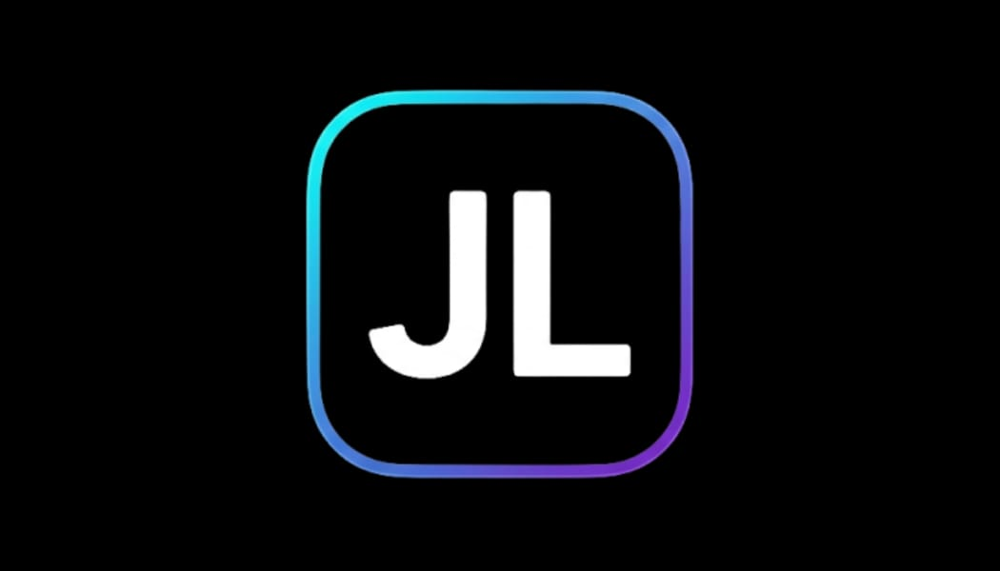

<p align="center">
  
</p>

<div align="center" >

# JLScript

### Uma linguagem de programação brasileira 🇧🇷

**Simples para começar. Estruturada para crescer.**

`JLS` • `.jls` • `JLScripter`

---

**Criada por Lucas Aguiel Dos Santos De Oliveira**

</div>

> **JLScript (JLS)** é uma linguagem de programação brasileira criada em 2026 por **Lucas Aguiel Dos Santos De Oliveira**. O projeto nasceu com a ideia de unir uma escrita simples e divertida a uma arquitetura capaz de crescer para projetos reais, com interpretador, runtime, compilação, bytecode, terminal próprio, bibliotecas nativas e ferramentas de desenvolvimento.

---

## Índice

- [Download](#download)
- [O que é JLScript?](#o-que-é-jlscript)
- [Visão geral](#visão-geral)
- [Primeiros passos](#primeiros-passos)
- [Sintaxe](#sintaxe)
- [Controle de fluxo](#controle-de-fluxo)
- [Funções](#funções)
- [Switch sem break](#switch-sem-break)
- [Bibliotecas nativas](#bibliotecas-nativas)
- [JLS CLI](#jls-cli)
- [Compilação e bytecode](#compilação-e-bytecode)
- [Arquitetura](#arquitetura)
- [Screenshots](#screenshots)
- [História](#história)
- [Origem do nome](#origem-do-nome)
- [JLScripter](#jlscripter)
- [Criador](#criador)
- [Status do projeto](#status-do-projeto)
- [Links](#links)

---

# Download

A forma recomendada de baixar o JLScript é pelas **Releases oficiais do repositório**.

### Download oficial

**[⬇ Baixar JLScript](https://github.com/eohlczinn/JLScript/releases/latest)**

**[📦 Ver todas as versões](https://github.com/eohlczinn/JLScript/releases)**

> Baixe sempre a versão publicada no repositório oficial. Assim você consegue conferir a versão, arquivos disponibilizados e notas da release antes da instalação.

Depois de instalar, abra o terminal e confirme que o comando `jls` está disponível:

```bash
jls --version
```

Para consultar os comandos:

```bash
jls --help
```

E para executar um arquivo:

```bash
jls run programa.jls
```


---

# O que é JLScript?

JLScript é uma linguagem criada no Brasil com foco em legibilidade, aprendizado e produtividade.

A proposta não é simplesmente copiar Python, JavaScript, C++ ou qualquer outra linguagem. O projeto aproveita ideias conhecidas da programação e experimenta decisões próprias de sintaxe, ferramentas e organização.

O JLScript começou pequeno. Sua primeira versão possuía recursos básicos como condicionais, funções, `switch`, `for`, loops e um CLI inicial. A partir dessa base, o projeto cresceu para incluir componentes como lexer, parser, AST, interpretador, runtime, compiladores, bytecode, bibliotecas nativas e uma CLI muito mais completa.

```text
Código .jls
    │
    ▼
  Lexer
    │
    ▼
  Parser
    │
    ▼
   AST
    │
    ├───────────────┐
    ▼               ▼
Interpretador   Compilação
    │               │
    ▼               ▼
 Runtime          Saídas
```

---

# Visão geral

| Área | JLScript |
|---|---|
| Extensão | `.jls` |
| CLI | `jls` |
| Execução | Interpretador + runtime |
| Análise | Lexer, Parser e AST |
| Build | Geração de C++ e fluxo de compilação |
| Bytecode | `.jlb` |
| REPL | JLShell / `jls repl` |
| Testes | `jls test` |
| Formatação | `jls fmt` |
| Análise estática | `jls lint` |
| Correções | `jls fix` |
| Diagnóstico | `jls doctor` |
| Atualização | `jls update` |
| Desenvolvimento | `jls dev` |
| Bibliotecas | Sistema de módulos/bibliotecas nativas |
| Idiomas | Construções em português e inglês |

> Nem todas as áreas do projeto possuem necessariamente o mesmo nível de maturidade. Recursos experimentais ou dependentes de integrações externas devem ser tratados como tais na documentação específica.

---

# Primeiros passos

Crie um arquivo:

```text
programa.jls
```

Execute:

```bash
jls run programa.jls
```

O comando `run` é o caminho direto para executar um arquivo `.jls` durante o desenvolvimento.

Também existe um ambiente interativo:

```bash
jls repl
```

---

# Sintaxe

O JLScript foi criado para permitir uma escrita direta e familiar.

Entre as palavras usadas pelo sistema de variáveis estão:

```jls
va nome = "JLScript"
let versao = "JLS"
ins ativo = true
```

O projeto também reconhece tipos e valores fundamentais utilizados pelo runtime, incluindo números, strings, booleanos, listas e `null`.

## Português e inglês

Uma das características do JLScript é a presença de construções em português e inglês.

Exemplo de condição em português:

```jls
se (ativo) {
    mostrar("Ativo")
} senao {
    mostrar("Desativado")
}
```

A linguagem também possui as formas correspondentes suportadas em inglês, como `if` e `else`.

A intenção é manter coerência dentro do código e tornar a linguagem confortável para quem está começando em português sem impedir uma escrita mais próxima do ecossistema internacional.

---

# Controle de fluxo

O JLScript possui estruturas de controle para decisões e repetição.

## Condições

```jls
se (idade >= 18) {
    mostrar("Maior de idade")
} senao {
    mostrar("Menor de idade")
}
```

## Laços

A linguagem possui estruturas como `while`/`enquanto` e `for`/`para`, além de controles de fluxo equivalentes a `break`/`pare` e `continue`/`continuar` nos contextos em que são utilizados.

Esses recursos permitem construir desde repetições simples até fluxos maiores de execução.

---

# Funções

Funções fazem parte do núcleo do JLScript.

A linguagem suporta a declaração explícita com `func`:

```jls
func saudacao(nome) {
    mostrar("Olá, " + nome)
}
```

E o projeto também possui suporte à forma curta de funções dentro de sua sintaxe:

```jls
soma(a, b) {
    retorne a + b
}
```

A intenção é reduzir ruído quando a estrutura já deixa claro que aquele bloco representa uma função.

---

# Switch sem break

Uma das diferenças de sintaxe do JLScript aparece no `switch`.

Em várias linguagens, é comum encontrar algo semelhante a:

```text
case ...
    ...
    break
```

No JLScript, cada `case` pode possuir seu próprio bloco:

```jls
switch (opcao) {
    case 1 {
        mostrar("Iniciar")
    }

    case 2 {
        mostrar("Configurações")
    }

    default {
        mostrar("Sair")
    }
}
```

Não é necessário escrever um `break` apenas para informar que o bloco terminou.

O próprio:

```text
}
```

delimita o fim daquele `case`.

Essa escolha representa uma das ideias do projeto: quando a estrutura do código já informa algo claramente, a linguagem não precisa obrigar o programador a repetir a mesma intenção.

---

# Bibliotecas nativas

O JLScript possui um sistema de importação para bibliotecas.

Para importar uma biblioteca:

```jls
import #api
```

Para importar várias:

```jls
import [#api, #database, #json]
```

A ideia é manter funcionalidades especializadas separadas do núcleo da linguagem.

Entre as áreas desenvolvidas ou exploradas pelo ecossistema estão APIs, dados, JSON, interfaces, estilos, dispositivos, conectores, testes e ferramentas de desenvolvimento de linguagens.

## Exemplo de organização

```text
JLScript
│
├── Núcleo da linguagem
│
├── Runtime
│
├── CLI
│
├── Compilação
│
└── Bibliotecas
    ├── #api
    ├── #database
    ├── #json
    ├── #ui
    ├── #style
    ├── #mobile
    ├── #connector
    └── #compiler
```

### `#api`

Área destinada às funcionalidades de APIs e HTTP.

```jls
import #api
```

### `#database`

Área destinada a recursos relacionados a banco de dados.

```jls
import #database
```

### `#json`

Recursos para trabalhar com JSON.

```jls
import #json
```

### `#ui` e `#style`

Bibliotecas voltadas à construção de interfaces e estilização dentro das propostas do ecossistema.

```jls
import [#ui, #style]
```

### `#mobile`

Área relacionada a funcionalidades e integrações com dispositivos móveis.

```jls
import #mobile
```

### `#connector`

Camada destinada às conexões utilizadas por outras áreas do projeto.

```jls
import #connector
```

### `#compiler`

Área voltada ao desenvolvimento e experimentação de linguagens utilizando infraestrutura do JLScript.

```jls
import #compiler
```

> Consulte a documentação específica das bibliotecas para saber quais funções estão estáveis, experimentais ou dependem de componentes externos.

---

# JLS CLI

O JLScript possui uma interface de linha de comando própria.

```bash
jls
```

O terminal começou pequeno na versão 1.0.0 e cresceu junto com a linguagem.

## Execução

```bash
jls run programa.jls
```

## REPL

```bash
jls repl
```

## Build

```bash
jls build programa.jls
```

O fluxo de build atual passa pela infraestrutura da linguagem, gera C++ e utiliza o compilador configurado pelo projeto para produzir código nativo.

## Bytecode

```bash
jls compile programa.jls
```

O comando `compile` trabalha com a representação de bytecode `.jlb` implementada pelo projeto.

## Testes

```bash
jls test
```

## Formatação

```bash
jls fmt
```

## Lint

```bash
jls lint
```

## Correções

```bash
jls fix
```

## Diagnóstico

```bash
jls doctor
```

## Atualização

```bash
jls update check
jls update
```

## Desenvolvimento

```bash
jls dev
jls dev build
jls dev watch
jls dev clean
jls dev status
```

## Configuração

```bash
jls config
```

A CLI também possui suporte a opções relacionadas à experiência do terminal, incluindo execução sem cores em ambientes incompatíveis ou logs automatizados.

```bash
jls --no-color
```

---

# Compilação e bytecode

O JLScript não ficou limitado a interpretar arquivos `.jls`.

O projeto possui caminhos de compilação diferentes.

## Build nativo

```text
arquivo.jls
    │
    ▼
Lexer
    │
    ▼
Parser / AST
    │
    ▼
Geração de C++
    │
    ▼
Compilador C++
    │
    ▼
Executável
```

Uso:

```bash
jls build programa.jls
```

## Bytecode JLS

Outro caminho gera arquivos `.jlb`:

```text
arquivo.jls
    │
    ▼
Compilador de bytecode
    │
    ▼
arquivo.jlb
```

Uso:

```bash
jls compile programa.jls
```

O bytecode do projeto representa instruções da linguagem e não deve ser confundido automaticamente com uma máquina virtual completa.

---

# Arquitetura

O crescimento do JLScript fez com que o projeto deixasse de ser apenas um pequeno interpretador.

Sua arquitetura passou a envolver diferentes subsistemas:

```text
JLScript
│
├── Lexer
│   └── transforma o código em tokens
│
├── Parser
│   └── interpreta a estrutura sintática
│
├── AST
│   └── representa o programa
│
├── Interpretador
│   └── executa estruturas da linguagem
│
├── Runtime
│   └── fornece o ambiente de execução
│
├── Compiladores
│   ├── fluxo nativo
│   └── bytecode .jlb
│
├── CLI
│   └── ferramentas jls
│
├── Módulos
│   └── sistema de importação
│
└── Bibliotecas
    └── funcionalidades especializadas
```

Essa arquitetura existe porque cada nova etapa do projeto começou a exigir responsabilidades próprias. Afinal, aparentemente criar "uma linguagem simples" era simples demais.

---

# Screenshots

A documentação já inclui imagens do projeto dentro da pasta `assets/`, portanto elas aparecem diretamente no GitHub sem depender de links externos.

<p align="center">
  
</p>

<p align="center">
  <em>Exemplo visual relacionado ao projeto JLScript.</em>
</p>

<p align="center">
  
</p>


---

# História

O JLScript nasceu em **2026**.

A ideia surgiu da vontade de criar algo que fosse ao mesmo tempo divertido de desenvolver e sério o bastante para continuar crescendo.

A proposta buscava combinar características que Lucas gostava em outras linguagens com decisões próprias.

A simplicidade encontrada em Python serviu como uma referência de experiência.

JavaScript trouxe familiaridade com estruturas e possibilidades de desenvolvimento.

Mas o objetivo nunca foi simplesmente reconstruir nenhuma delas.

O JLScript começou como uma resposta a uma pergunta pessoal:

> Como seria uma linguagem se eu pudesse decidir como determinadas coisas deveriam funcionar?

A resposta começou com código.

---

## JLScript 1.0.0

A primeira versão oficial foi a **1.0.0**.

Ela possuía poucos recursos quando comparada ao projeto atual.

Entre eles estavam:

- `if`;
- `else`;
- funções;
- `switch`;
- `for`;
- loops;
- execução básica;
- um CLI inicial.

Não existia o ecossistema atual de bibliotecas.

O terminal também era muito menor.

Um dos comandos existentes era algo tão simples quanto:

```bash
jls version
```

Mas aquela versão cumpriu sua função mais importante:

**o JLScript funcionava.**

---

## Antes e depois

```text
JLScript 1.0.0
│
├── condições
├── funções
├── switch
├── loops
└── CLI pequeno
```

Com o crescimento:

```text
JLScript
│
├── Linguagem
│   ├── Lexer
│   ├── Parser
│   └── AST
│
├── Execução
│   ├── Interpretador
│   └── Runtime
│
├── Compilação
│   ├── C++ nativo
│   └── Bytecode .jlb
│
├── Ferramentas
│   ├── run
│   ├── repl
│   ├── build
│   ├── compile
│   ├── test
│   ├── fmt
│   ├── lint
│   ├── fix
│   ├── doctor
│   ├── update
│   └── dev
│
└── Bibliotecas nativas
```

O que começou como uma pequena linguagem passou a ser tratado como um ecossistema.

---

# Origem do nome

O nome **JLScript** possui uma origem pessoal.

```text
J       → Joicy
L       → Lucas
Script  → Programação

J + L + Script
      ↓
   JLScript
```

O **J** representa **Joicy Costa**.

O **L** representa **Lucas Aguiel Dos Santos De Oliveira**.

E **Script** representa a programação.

O `J` não significa Java nem JavaScript.

Joicy não participa tecnicamente do desenvolvimento da linguagem. Ela não criou a sintaxe, o interpretador ou as bibliotecas. Sua presença no nome é uma homenagem e representa sua importância na história pessoal de Lucas.

Lucas e Joicy possuem objetivos profissionais diferentes. Lucas segue seu interesse por programação, desenvolvimento de software e segurança cibernética. Joicy possui seus próprios objetivos e interesses.

Eles não precisam seguir a mesma profissão para fazer parte da história um do outro.

Foi essa ideia que ficou registrada no próprio nome do projeto.

```text
Joicy + Lucas + Programação
             │
             ▼
          JLScript
```

---

# JLScripter

**JLScript** é a linguagem.

**JLS** é sua abreviação.

**`.jls`** é a extensão utilizada pelos arquivos da linguagem.

**JLScripter** representa a identidade mais ampla construída ao redor do projeto e de seu ecossistema.

```text
JLScripter
│
├── JLScript
├── Runtime
├── Compiladores
├── Bytecode
├── CLI
├── Bibliotecas
├── Ferramentas
└── Documentação
```

---

# Criador

## Lucas Aguiel Dos Santos De Oliveira

Lucas Aguiel Dos Santos De Oliveira é um programador brasileiro, estudante de tecnologia e criador do JLScript/JLScripter.

Seu interesse está concentrado principalmente em:

- programação;
- desenvolvimento de software;
- linguagens de programação;
- arquitetura de sistemas;
- segurança cibernética;
- inteligência artificial;
- ferramentas para desenvolvedores.

Uma parte importante de seu aprendizado acontece através da construção de projetos próprios.

Em vez de esperar conhecer cada assunto antes de começar, muitos projetos seguem um ciclo parecido:

```text
Ideia
  ↓
Construção
  ↓
Problema
  ↓
Pesquisa
  ↓
Solução
  ↓
Nova ideia
```

Foi assim que a criação de uma linguagem começou a exigir conhecimento sobre lexer, parser, AST, runtime, compiladores, bytecode, terminal, rede e diversas outras áreas.

O JLScript também registra essa evolução técnica.

A primeira versão era pequena.

O projeto atual é consideravelmente maior.

E sua história ainda está sendo escrita.

---

# Uma linguagem brasileira

O JLScript é um projeto originalmente brasileiro.

Ele nasceu no Brasil e possui o português como parte importante de sua identidade.

A linguagem busca permitir que conceitos de programação possam ser expressos de maneira natural sem abandonar a possibilidade de utilizar construções em inglês.

```jls
se (usuario.ativo) {
    mostrar("Bem-vindo")
}
```

A existência do português não significa que o projeto precise ficar limitado ao Brasil.

A proposta é justamente o contrário: ter identidade própria e ainda poder crescer para fora dela.

---

# Filosofia do projeto

Algumas ideias ajudam a explicar as decisões tomadas no JLScript.

### Simplicidade

Se uma estrutura pode ser clara sem sintaxe adicional, não existe motivo para adicionar ruído apenas porque outra linguagem faz assim.

### Legibilidade

Código deve ser compreensível por quem o escreveu e por quem precisar lê-lo depois.

### Experimentação

JLScript também é um espaço para testar ideias sobre sintaxe, runtime, compilação e ferramentas.

### Aprendizado

O desenvolvimento da própria linguagem serve como forma de estudar profundamente os componentes que normalmente ficam escondidos por trás de um compilador ou interpretador.

### Evolução

O projeto não precisa nascer completo.

Ele precisa continuar capaz de crescer.

---

# Status do projeto

JLScript está em desenvolvimento ativo.

Isso significa que:

- recursos podem evoluir;
- sintaxe pode receber ajustes;
- bibliotecas podem mudar;
- funcionalidades experimentais podem ser estabilizadas ou redesenhadas;
- documentação pode acompanhar alterações do código-fonte.

Para projetos reais, confira sempre a versão da linguagem e a documentação correspondente.

---

# Links

### Repositório principal

[GitHub — JLScript](https://github.com/eohlczinn/JLScript)

### Site / documentação

[Projeto jlscript.dev](https://github.com/eohlczinn/jlscript.dev)

## Download

### Windows

Baixe o executável do JLScript:

[⬇️ **1 Baixar JLScript.exe**](./downloads/jls.exe)

[⬇️ **2 Baixar JLScript-2.3.0-windows-x64-setup.exe**](./downloads/JLScript-2.3.0-windows-x64-setup.exe)

Depois, verifique a instalação:

```powershell
jls --version

---

# Comece pelo terminal

Depois de instalar o JLScript:

```bash
jls --version
```

Crie ou abra um arquivo `.jls` e execute:

```bash
jls run programa.jls
```

Para explorar as ferramentas:

```bash
jls --help
```

---

<div align="center">

## JLScript

**Uma linguagem brasileira. Um projeto em evolução.**

`J = Joicy` • `L = Lucas` • `Script = Programação`

Criado por **Lucas Aguiel Dos Santos De Oliveira**

🇧🇷

</div>
